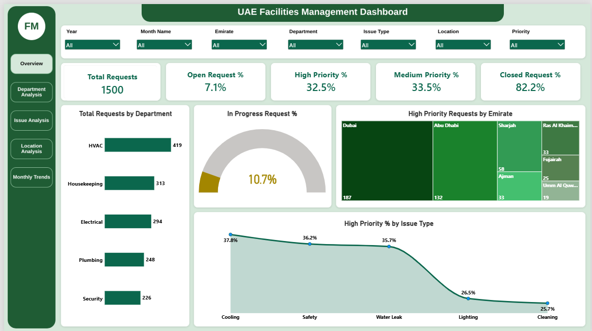

# UAE Facilities Management Dashboard (Power BI)

An interactive Power BI dashboard for tracking facilities management requests across the seven emirates.

## Pages
- Overview
- Department Analysis
- Issue Analysis
- Location Analysis
- Monthly Trends

## Files
| File | Description |
|---|---|
| `FM_Dashboard.pbix` | Power BI report |
| `UAE_FM_Dataset.xlsx` | Sample data: 1,500 requests, 1 Jan 2025 to 25 Nov 2026, plus a Calendar table |

## How to use
1. Download both files.
2. Open `FM_Dashboard.pbix` in Power BI Desktop.
3. To refresh, go to **Transform data > Data source settings > Change Source** and select your copy of `UAE_FM_Dataset.xlsx`.
4. Use the left menu to switch pages (Ctrl+click in Desktop).

## Data disclaimer
The data is synthetic and created for demonstration only. It does not represent real organisations or official UAE statistics. SLA targets (High 2, Medium 5, Low 10 days) are assumptions.
